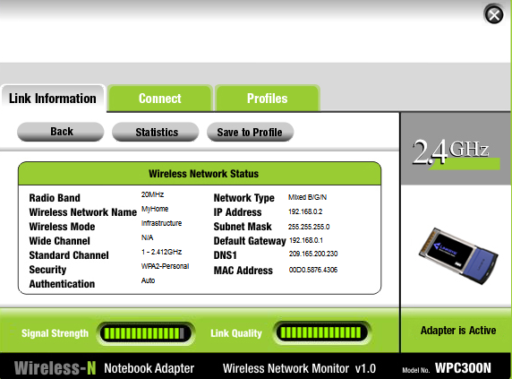

# Configurar um roteador sem fio e clientes (Packet Tracer)

Laboratório do Cisco Networking Academy (NetAcad), feito no Cisco Packet Tracer.

## Cenário

Uma amiga pediu ajuda para conectar a casa nova à rede de TV a cabo. O objetivo era
ligar os dispositivos, configurar um roteador sem fio doméstico para entregar
endereços IP por DHCP e criar uma rede Wi-Fi segura para os dispositivos da casa.

## Resultado Final

Dispositivos: cable splitter, cable modem, TV, Home Wireless Router, Office PC
(cabeado), Bedroom PC (cabeado) e Laptop (sem fio).

## O que eu fiz

### Parte 1: Conexão dos dispositivos
- Cabos coaxiais: splitter -> cable modem (serviço de internet) e splitter -> TV (vídeo)
- Cabo direto de cobre: cable modem -> porta Internet do roteador sem fio
- Office PC -> GigabitEthernet 1 e Bedroom PC -> GigabitEthernet 2 do roteador

### Parte 2: Configuração do roteador (via interface web)
- Acesso à GUI pelo gateway padrão obtido por DHCP (rede 192.x)
- DHCP: número máximo de usuários limitado a 10
- Senha padrão de admin alterada (boa prática: nunca manter credenciais de fábrica)
- Wi-Fi 2,4 GHz ativado, SSID alterado para `MyHome`
- Segurança **WPA2 Personal** com senha

### Parte 3: Endereçamento e testes
- Laptop conectado ao Wi-Fi e recebendo IP por DHCP
- Bedroom PC configurado para DHCP
- Teste de conectividade: os três dispositivos acessam `skillsforall.srv` pelo navegador

## Resultado

Todos os dispositivos (2 cabeados e 1 sem fio) receberam IP por DHCP e têm acesso à
"internet" simulada.

## Conceitos praticados

DHCP, gateway padrão, roteador doméstico (switch + roteador + access point),
rede cabeada x sem fio, SSID, WPA2 Personal, boas práticas de senha, teste de
conectividade.

## Arquivos

- `Configurar um Roteador sem fio e um cliente.pka`: arquivo do Packet Tracer
