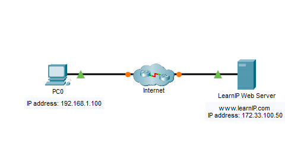
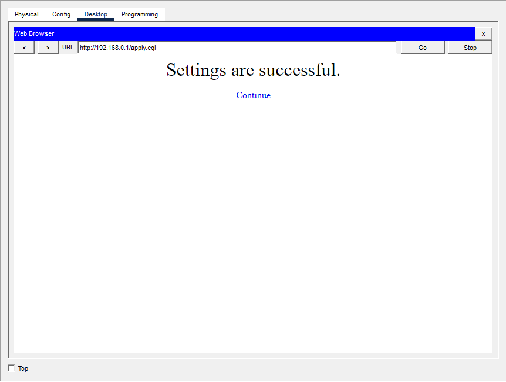

# Packet Tracer – Conectar-se a um servidor Web

Lab do Cisco Networking Academy (NetAcad) feito no Cisco Packet Tracer. O objetivo é observar como um host se comunica com um servidor Web usando endereços IP: primeiro testando a conectividade com `ping` e depois acessando a página pelo navegador.

## Objetivo

Observar como os pacotes são enviados pela Internet usando endereços IP.

## Ferramentas

- Cisco Packet Tracer
- Prompt de comando (Command Prompt) do PC
- Web Browser do PC

## Topologia

| Dispositivo | Função | Endereço IP |
|-------------|--------|-------------|
| PC0 | Host de origem (cliente) | 192.168.1.100 |
| Servidor Web | Host de destino | 172.33.100.50 |



## Passo a passo

### Parte 1: Verificar a conectividade com o servidor Web

1. Selecionar o **PC0**.
2. Abrir **Desktop > Command Prompt**.
3. Executar o ping para o IP do servidor:

```
PC> ping 172.33.100.50
```

**Resultado:**

```
Pinging 172.33.100.50 with 32 bytes of data:

Reply from 172.33.100.50: bytes=32 time=0ms TTL=127
Reply from 172.33.100.50: bytes=32 time=0ms TTL=127
Reply from 172.33.100.50: bytes=32 time=0ms TTL=127
Reply from 172.33.100.50: bytes=32 time=0ms TTL=127

Ping statistics for 172.33.100.50:
    Packets: Sent = 4, Received = 3, Lost = 1 (25% loss),
Approximate round trip times in milli-seconds:
    Minimum = 0ms, Maximum = 0ms, Average = 0ms
```


### Parte 2: Acessar o servidor Web pelo navegador

1. No **PC0**, abrir **Desktop > Web Browser**.
2. Digitar `172.33.100.50` na URL e clicar em **Go**.
3. O cliente Web se conecta ao servidor pelo endereço IP e abre a página Web.

### Pergunta do lab

**Quais mensagens você viu após a página Web ter sido carregada?**

**Resposta:** Welcome to the Learn IP Web Site. You were able to reach this website because you had the IP address of the web server. The connecting PC also had a web client running on the device



## O que aprendi

- **Teste de conectividade:** o `ping` usa o protocolo ICMP e confirma que o host de origem consegue alcançar o destino. Uma resposta já indica que o caminho está funcionando.
- **Perda de pacote no início:** o primeiro pacote pode dar timeout enquanto os dispositivos carregam e o **ARP** resolve o endereço MAC do próximo salto. Por isso é comum perder 1 de 4 pacotes no primeiro ping, e isso não indica falha na rede.
- **TTL = 127:** o valor inicial do TTL nos hosts do Packet Tracer é 128, e cada roteador no caminho reduz 1. Um TTL de 127 indica que o pacote passou por um roteador entre o PC0 e o servidor, ou seja, eles estão em redes diferentes.
- **Acesso por IP:** o navegador consegue abrir a página digitando só o endereço IP, sem precisar de DNS. O nome de domínio serve apenas para facilitar a vida do usuário.

## Habilidades praticadas

`Cisco Packet Tracer` · `ICMP / ping` · `Endereçamento IP` · `ARP` · `Teste de conectividade` · `Cliente-servidor HTTP` · `Troubleshooting básico de rede`

## Contexto

Lab realizado durante a trilha de formação **CCST (Cisco Certified Support Technician)** do Cisco Networking Academy.
