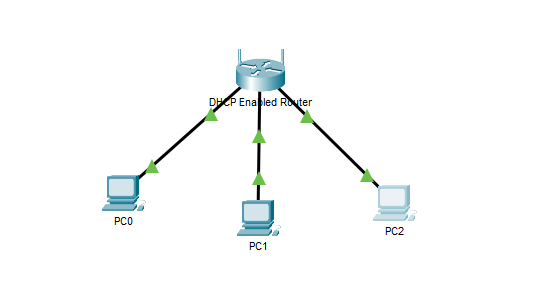
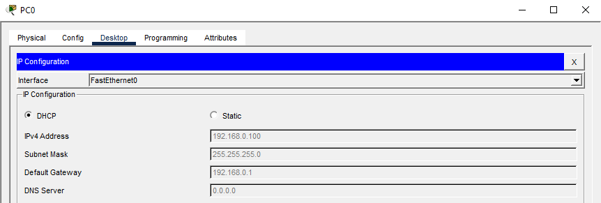
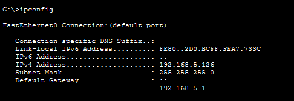
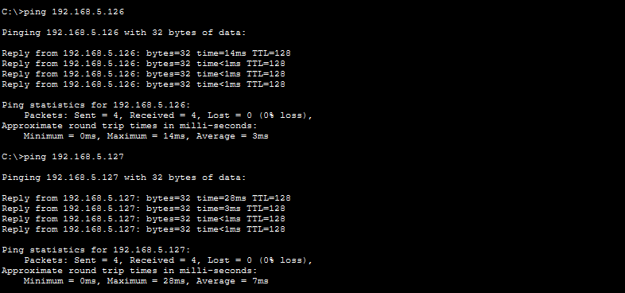

# Packet Tracer – Configuração do DHCP em um Roteador Wireless (sem fio)

Lab do Cisco Networking Academy (NetAcad) feito no Cisco Packet Tracer. Um usuário doméstico quer conectar 3 PCs a um roteador sem fio, e todos devem receber o endereço IP automaticamente por DHCP. No lab, alterei o IP do roteador e a faixa de endereços DHCP, e depois verifiquei se os PCs recebiam as novas configurações.

## Objetivos

- Conectar 3 PCs a um roteador sem fio
- Alterar a configuração do DHCP para uma faixa de rede específica
- Configurar os clientes para obter seus endereços por DHCP

## Ferramentas

- Cisco Packet Tracer
- Interface web do roteador sem fio
- Prompt de comando (Command Prompt) dos PCs

## Topologia

3 PCs genéricos (PC0, PC1 e PC2), cada um ligado por cabo direto a uma porta Ethernet do roteador sem fio.



## Passo a passo

### Parte 1: Montar a topologia

1. Adicionar três PCs genéricos.
2. Conectar cada PC a uma porta Ethernet do roteador sem fio com cabo direto.

### Parte 2: Observar as configurações DHCP padrão

1. Com as luzes verdes, abrir **PC0 > Desktop > IP Configuration** e selecionar **DHCP**.
2. Anotar o endereço do gateway padrão: **192.168.0.1**.
3. Abrir o **Web Browser**, digitar o IP do gateway e entrar com o usuário e a senha padrão do roteador.
4. Na página **Basic Setup**, observar que o DHCP está ativado, o endereço inicial da faixa e o intervalo de endereços disponíveis.



### Parte 3: Alterar o IP padrão do roteador

1. Em **Router IP**, alterar o endereço para **192.168.5.1**.
2. Clicar em **Save Settings**. A página mostra um erro, o que é esperado, porque o roteador mudou de rede.
3. No PC0, em **IP Configuration**, alternar para **Static** e voltar para **DHCP** para renovar o endereço.
4. Abrir o navegador e acessar **192.168.5.1**.

### Parte 4: Alterar a faixa de endereços DHCP

1. Observar que o endereço inicial do DHCP foi atualizado para a mesma rede do roteador (192.168.5.100).
2. Alterar o endereço inicial para **192.168.5.126**.
3. Alterar o **Maximum Number of Users** para **75**.
4. Salvar, fechar o navegador e renovar o IP do PC0 (Static → DHCP).
5. No **Command Prompt**, executar `ipconfig`.

**Resultado:** o PC0 recebeu o IP **192.168.5.126**.



### Parte 5: Ativar o DHCP nos outros PCs

1. No PC1: **Desktop > IP Configuration > DHCP**.
2. Repetir o mesmo processo no PC2.

**Resultado:** o PC1 recebeu o IP **192.168.5.127**.

### Parte 6: Verificar a conectividade

o PC2 recebeu o IP **192.168.5.128**.

No Command Prompt do PC2:

```
ipconfig
ping 192.168.5.1      (roteador)
ping 192.168.5.126    (PC0)
ping 192.168.5.127    (PC1)
```

Os pings para todos os dispositivos foram bem-sucedidos.



## Resumo dos endereços

| Dispositivo | Endereço IP |
|-------------|-------------|
| Roteador (padrão) | 192.168.0.1 |
| Roteador (alterado) | 192.168.5.1 |
| PC0 | 192.168.5.126 |
| PC1 | 192.168.5.127 |
| PC2 | 192.168.5.128 |

## O que aprendi

- **DHCP:** serviço que entrega endereço IP, máscara e gateway automaticamente aos clientes, sem configuração manual em cada PC.
- **Faixa DHCP:** o endereço inicial define o primeiro IP que o roteador entrega, e o número máximo de usuários limita quantos clientes podem receber endereço. Com início em .126 e 75 usuários, a faixa vai até 192.168.5.200.
- **Renovar o IP:** ao mudar a rede do roteador, os clientes continuam com o endereço antigo. Alternar entre Static e DHCP força o PC a pedir um novo endereço.
- **Gateway padrão:** é o IP do roteador, por onde os PCs alcançam outras redes e acessam a página de administração.
- **Verificação:** `ipconfig` mostra a configuração recebida e o `ping` confirma a comunicação entre todos os dispositivos.

## Habilidades praticadas

`Cisco Packet Tracer` · `DHCP` · `Endereçamento IP` · `Gateway padrão` · `Configuração de roteador sem fio` · `Rede LAN` · `ipconfig` · `Teste de conectividade (ping)`

## Contexto

Lab realizado durante a trilha de formação **CCST (Cisco Certified Support Technician)** do Cisco Networking Academy.